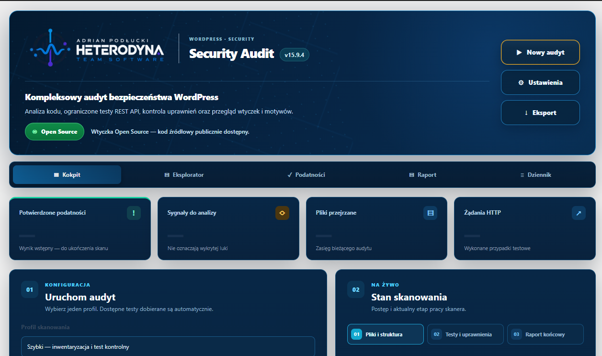

  

<h1 align="center">Heterodyna Security Audit</h1>

  <strong>Audyt bezpieczeństwa WordPress oparty na dowodach, a nie samych alarmach.</strong> 
  Wtyczka open source dla administratorów i osób testujących własne instalacje WordPress.

  <a href="https://github.com/HeterodynaTeamSoftware/Hererodyna-Security-Audit/releases"><strong>📦 POBIERZ WTYCZKĘ — RELEASES</strong></a>
  &nbsp;·&nbsp;
  <a href="https://heterodynateamsoftware.pl/projekty/hererodyna-security-audit/">Strona projektu</a>
  &nbsp;·&nbsp;
  <a href="https://github.com/HeterodynaTeamSoftware/Hererodyna-Security-Audit/issues">Zgłoś problem</a>

---

## Zrzuty ekranu

### Kokpit audytu — v15.9.4

*Oryginalny zrzut interfejsu Heterodyna Security Audit v15.9.4.*

## O projekcie

**Heterodyna Security Audit v15.9.4** to wtyczka do WordPress, która wspiera diagnostykę potencjalnych problemów bezpieczeństwa i zbieranie materiału dowodowego. Łączy analizę statyczną, kontrolę uprawnień i wybrane testy przeznaczone dla kontrolowanego środowiska. Nie należy traktować samej obecności podejrzanego wzorca w kodzie jako potwierdzonej podatności.

### Najważniejsze możliwości

- **Analiza źródeł** — inwentaryzacja kodu i statyczne kontrole m.in. ścieżek SQL, XSS, CSRF i operacji na plikach.
- **REST i uprawnienia** — analiza punktów wejścia, obsługi żądań oraz mechanizmów autoryzacji (AuthZ) i kontroli dostępu.
- **Dowody i klasyfikacja** — rozróżnienie sygnałów wymagających sprawdzenia od ustaleń mających potwierdzony materiał dowodowy; korelacja z aktualnym plikiem i jego SHA-256.
- **Kontrolowane testy i ponowne sprawdzenie** — zestawy diagnostyczne przeznaczone do własnej, izolowanej instalacji testowej; część aktywnych działań wymaga świadomego uruchomienia.
- **Raporty** — przegląd ustaleń i eksport do **JSON / HTML**.
- **Ciemny interfejs** — pięć widoków: **Kokpit, Eksplorator, Podatności, Raport, Dziennik**; wskaźniki stanu i podgląd aktualnie indeksowanych plików.

> **Ważne:** lista plików i wstępny podgląd skanowania nie są listą podatności. Znaleziony wzorzec nie oznacza automatycznie możliwości jego wykorzystania. Wtyczka nie zastępuje ręcznego audytu bezpieczeństwa ani testów w rzeczywistym środowisku.

## Instalacja

1. Otwórz **[GitHub Releases](https://github.com/HeterodynaTeamSoftware/Hererodyna-Security-Audit/releases)** i pobierz instalacyjny plik ZIP udostępniony w wybranym wydaniu.
2. W WordPress przejdź do **Wtyczki → Dodaj nową → Wyślij wtyczkę na serwer**.
3. Wybierz paczkę ZIP, zainstaluj i aktywuj wtyczkę.
4. W panelu administratora otwórz **Narzędzia → Heterodyna Audit**.

Do pracy z kodem źródłowym skopiuj katalog [`heterodyna-audit/`](heterodyna-audit/) do `wp-content/plugins/` w **testowej** instalacji WordPress. Nie kopiuj całego repozytorium jako pojedynczej wtyczki.

### Wymagania

| Element | Wymaganie |
| --- | --- |
| WordPress | 6.0 lub nowszy |
| PHP | 7.4 lub nowszy |
| Uprawnienia | Administrator (`manage_options`); w multisite superadministrator |

**Zalecenie:** przed audytem wykonaj kopię zapasową i użyj odizolowanego stagingu, szczególnie przy uruchamianiu aktywnych prób HTTP. Nie testuj cudzych witryn bez upoważnienia.

## Licencja i autor

**GPL-2.0-or-later** — [LICENSE](LICENSE). Projekt rozwijany przez [Heterodyna Team Software](https://heterodynateamsoftware.pl/).
